# Dinoyo Craft — Web Admin Dashboard

Panel admin **Kampung Wisata Keramik Dinoyo** untuk paguyuban pengrajin keramik Kota Malang. Aplikasi ini adalah hasil *slicing* desain Figma
[High Fidelity – Web Admin](https://www.figma.com/design/P5Fpfan6VAXFfdU2q96yxk/Kampung-Wisata-Keramik-Dinoyo?node-id=223-2)
menjadi aplikasi **Next.js 16 (App Router)** yang terhubung ke REST API **Express.js 5** dengan database **MySQL**.

| Layer | Teknologi | Folder |
| --- | --- | --- |
| Frontend (UI, SEO, rendering) | Next.js 16 · React 19 · TypeScript · Tailwind CSS 4 · ESLint | [`frontend/`](frontend/) |
| Backend (REST API) | Express.js 5 · TypeScript · Prisma ORM 7 · tsx | [`backend/`](backend/) |
| Database | MySQL 8 / MariaDB 10.4+ (XAMPP) | [`backend/prisma/schema.prisma`](backend/prisma/schema.prisma) + [`migrations/`](backend/prisma/migrations/) |

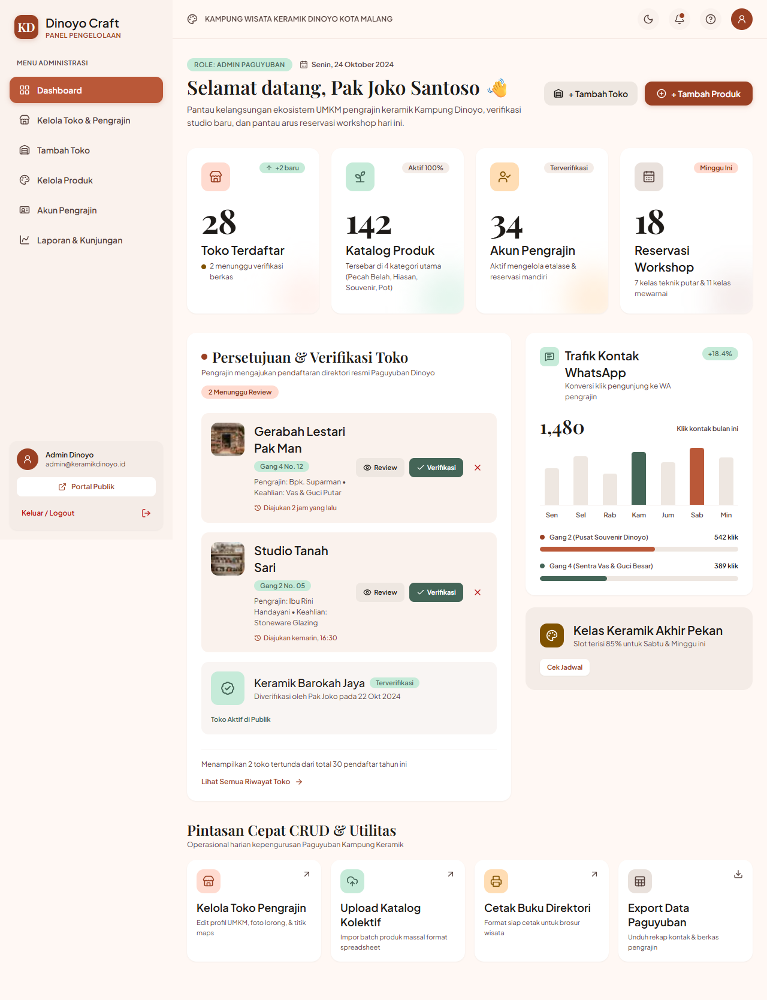

---

## Daftar Isi

1. [Fitur](#fitur)
2. [Cara Menjalankan](#cara-menjalankan)
3. [Struktur Folder](#struktur-folder)
4. [Daftar Library](#daftar-library)
5. [Endpoint API](#endpoint-api)
6. [Implementasi Materi Backend (Pertemuan 4–7)](#implementasi-materi-backend-pertemuan-47)
7. [Auth, Form Validation & Prisma](#auth-form-validation--prisma)
8. [File Upload & Cloud Storage (Vercel Blob)](#file-upload--cloud-storage-vercel-blob)
9. [Keamanan, Error & Logging](#keamanan-error--logging)
10. [Performa, SEO & Advanced Rendering (Pertemuan 14)](#performa-seo--advanced-rendering-pertemuan-14)
11. [Timer Pengajuan, Peta Lorong, Validasi & Lapisan Models](#timer-pengajuan-peta-lorong-validasi--lapisan-models)
12. [Pemetaan Kriteria Penilaian](#pemetaan-kriteria-penilaian)
13. [Responsif](#responsif)
14. [Screenshot](#screenshot)

---

## Fitur

Ada 8 layar sesuai frame Figma halaman *High Fidelity-Web Admin*:

| Layar Figma | Rute | Fungsi |
| --- | --- | --- |
| Login Admin | `/login` | Validasi form, tampil/sembunyikan kata sandi, "Ingat saya", pesan error dari API |
| *(Daftar Pengrajin)* | `/daftar` | Registrasi mandiri: validasi per kolom (email wajib berformat `nama@domain.com`, umur/NIK/WhatsApp hanya angka, kata sandi huruf+angka, konfirmasi sandi). Akun baru berstatus *menunggu* sampai diaktifkan admin di `/akun` |
| Dashboard Admin | `/dashboard` | KPI, verifikasi/tolak pengajuan toko, grafik klik WhatsApp, pintasan CRUD |
| Kelola Toko & Pengrajin | `/toko` | Pencarian, filter lokasi/kategori/status, pilih baris, paginasi, hapus dengan dialog konfirmasi |
| Tambah Toko | `/toko/tambah` | Formulir lengkap dengan validasi, editor narasi, unggah foto (pratinjau), toggle status |
| *(Edit Toko)* | `/toko/[slug]` | Rute dinamis: formulir yang sama terisi data toko, mode "Pembaruan Aktif" |
| Kelola Produk & Katalog | `/produk` | Filter toko/kategori, chip kategori, tampilan tabel ↔ grid, bagikan, hapus |
| Kelola Akun Pengrajin | `/akun` | Filter peran/status/lorong, ubah status akun lewat dialog (PATCH ke API) |
| Laporan Kunjungan & Reservasi | `/laporan` | Grafik tren berkelompok, sebaran lorong, riwayat reservasi + pencarian, menu ekspor |
| Logout | dialog | Konfirmasi keluar, cabut sesi di server & hapus cookie, kembali ke `/login` |

Fitur tambahan: **mode gelap** (tersimpan di `localStorage`), **toast notifikasi**, **proteksi rute** dengan `proxy.ts`,
halaman `loading`, `error`, dan `not-found` khusus.

---

## Cara Menjalankan

**Prasyarat:** Node.js ≥ 20 (diuji dengan Node 24), npm, dan MySQL 8 / MariaDB 10.4+ (mis. dari XAMPP).

### 1. Database (MySQL)

Nyalakan MySQL dari **XAMPP Control Panel → MySQL → Start**. Tabel dibuat oleh **migrasi Prisma** pada langkah 2.

### 2. Backend (Express.js) — terminal pertama

```bash
cd backend
npm install                 # juga menjalankan `prisma generate`
cp .env.example .env        # sesuaikan DB_USER / DB_PASSWORD bila bukan default XAMPP (root, tanpa password)
npm run db:reset            # buat database "dinoyo_admin", jalankan semua migrasi, isi data awal
npm run dev                 # http://localhost:4000/api
```

### 3. Frontend (Next.js) — terminal kedua

```bash
cd frontend
npm install
cp .env.example .env.local  # NEXT_PUBLIC_API_URL=http://localhost:4000/api
npm run dev                 # http://localhost:3000
```

Buka <http://localhost:3000>. Anda akan diarahkan ke halaman login.

| Akun demo (username / email) | Kata sandi | Peran | Akses |
| --- | --- | --- | --- |
| `admin` / `admin@keramikdinoyo.id` | `dinoyo123` | Admin Paguyuban | Semua menu |
| `bambang` / `bambang@sariasihkeramik.id` | `sariasih123` | Pemilik Toko | Hanya toko & produk Toko Keramik Sari Asih |
| `sri` / `sri@gerabahdinoyo.id` | `gerabah123` | Pemilik Toko | Hanya toko & produk Sanggar Gerabah Ibu Sri |
| `joko` / `joko@suvenirmelati.com` | `melati123` | Pemilik Toko | Akun ditangguhkan → login ditolak (403) |

### Skrip lain

| Folder | Perintah | Kegunaan |
| --- | --- | --- |
| `frontend` | `npm run build && npm start` | Build & jalankan mode produksi |
| `frontend` | `npm run lint` | Pemeriksaan ESLint |
| `frontend` | `npm run analyze` / `npm run analyze:simpan` | Analisis bundle per rute (UI interaktif) / simpan hasilnya ke `.next/diagnostics` untuk dibandingkan sebelum–sesudah |
| `frontend` | `npm test` | Tes Vitest: error boundary, 404, Server Action saat API gagal, validasi unggah |
| `backend` | `npm test` | Tes `node:test` + supertest (tanpa MySQL/Vercel Blob): 4xx/401/403/404/500, rate limit, request ID, log, unggah |
| `backend` | `npm run build && npm start` | Kompilasi TypeScript ke `dist/` lalu jalankan |
| `backend` | `npm run typecheck` | Pemeriksaan tipe tanpa build |
| `backend` | `npm run db:reset` | **Menghapus & membuat ulang** semua tabel lewat migrasi lalu mengisi data awal |
| `backend` | `npm run db:migrate -- --name <nama>` | Buat & jalankan migrasi baru setelah mengubah `prisma/schema.prisma` |
| `backend` | `npm run db:deploy` / `db:status` | Jalankan migrasi yang belum ada tanpa menghapus data / cek status migrasi |
| `backend` | `npm run db:seed` / `db:studio` | Isi ulang data demo / buka Prisma Studio |
| `backend` | `npm run db:katalog` | **Tanpa menghapus data**: tambahkan toko & produk demo yang belum ada (total 16 toko, 44 produk) dan samakan `jumlah_produk` tiap toko |

> Data disimpan di **MySQL**, jadi perubahan (tambah/edit/hapus toko, status akun, sesi login) tetap ada walau server di-restart.
> Jalankan `npm run db:reset` untuk mengembalikan data ke kondisi awal.
>
> **Database lama (dibuat dengan `schema.sql` sebelum Prisma):** pertahankan datanya dengan *baseline* —
> tandai migrasi awal sebagai sudah dijalankan, lalu jalankan migrasi berikutnya:
> `npx prisma migrate resolve --applied 20261104000000_init` → `npm run db:deploy`.
> Struktur `schema.sql` lama identik dengan migrasi `init`. Bila database lama belum punya kolom `akun.umur`, jalankan dulu
> `ALTER TABLE akun ADD COLUMN umur TINYINT UNSIGNED NULL AFTER nama;`

---

## Struktur Folder

```text
Website Admin/
├── backend/                       # REST API Express.js + TypeScript + Prisma (MySQL)
│   ├── prisma/
│   │   ├── schema.prisma          # Model data (sumber kebenaran struktur tabel)
│   │   ├── migrations/            # File SQL migrasi berurutan (init, login_tracking, ...)
│   │   └── seed.ts                # Data awal (`npm run db:seed`)
│   ├── prisma.config.ts           # Konfigurasi Prisma CLI (URL dari DB_* di .env)
│   ├── src/
│   │   ├── config/
│   │   │   └── env.ts             # Variabel .env (dotenv) + validasi wajib-isi
│   │   ├── lib/                   # prisma.ts (client + transaksi), validate.ts, validatePassword.ts
│   │   ├── generated/prisma/      # Prisma Client hasil `prisma generate` (tidak di-commit)
│   │   ├── middleware/            # requestContext, normalizeHeaders, securityHeaders, responseFormatter, requireJson,
│   │   │                          # validate, authMiddleware, requireRole, rateLimiter, cacheControl, logger, errorHandler
│   │   ├── routes/                # Router modular per fitur (*.routes.ts) + index.ts sebagai peta API
│   │   ├── validators/            # Skema validasi input per endpoint
│   │   ├── controllers/           # Baca req.validated → panggil service → res.success()
│   │   ├── services/              # Logika bisnis async + transaksi multi-langkah
│   │   ├── repositories/          # Query Prisma Client + transformasi model → JSON API
│   │   ├── auth/                  # Hash kata sandi, kebijakan RBAC/ABAC, session store (tabel sessions)
│   │   ├── data/                  # Data awal (seed) & data laporan statis
│   │   ├── types/                 # Model data + express.d.ts (augmentasi tipe Request/Response)
│   │   ├── utils/                 # HttpError, validator skema, sanitasi field sensitif, slugify
│   │   ├── app.ts                 # Urutan middleware & mounting router
│   │   └── index.ts               # Entry point: cek koneksi DB, listen, graceful shutdown
│   └── tsconfig.json
│
├── frontend/                      # Next.js App Router
│   ├── public/images/             # Aset foto (diekspor dari Figma)
│   └── src/
│       ├── app/                   # ROUTING (App Router)
│       │   ├── (auth)/login/      # Grup rute tanpa memengaruhi URL → /login (page.tsx · layout.tsx · components/LoginForm)
│       │   ├── (auth)/daftar/     # /daftar — pendaftaran pengrajin (components/RegisterForm)
│       │   ├── (admin)/           # Grup rute admin (berbagi Sidebar + Header)
│       │   │   ├── layout.tsx     # Layout bersama
│       │   │   ├── loading.tsx    # Loading UI saat Server Component menunggu data
│       │   │   ├── error.tsx      # Error boundary — isolasi crash per halaman
│       │   │   ├── dashboard/     # /dashboard
│       │   │   │   ├── page.tsx   # Ambil data → panggil komponen
│       │   │   │   ├── layout.tsx # Menata komponen halaman ini
│       │   │   │   ├── loading.tsx
│       │   │   │   └── components/ # Komponen khusus halaman ini (KpiGrid, VerificationPanel, ...)
│       │   │   ├── toko/          # /toko, /toko/tambah, /toko/[slug] — pola sama; formulir toko di components/form/
│       │   │   ├── produk/        # /produk   (page.tsx · layout.tsx · components)
│       │   │   ├── akun/          # /akun     (page.tsx · layout.tsx · components)
│       │   │   └── laporan/       # /laporan  (page.tsx · layout.tsx · components)
│       │   ├── layout.tsx         # Root layout (font, ThemeProvider, ToastProvider, UserAuthProvider)
│       │   ├── not-found.tsx · global-error.tsx · globals.css (design tokens)
│       ├── components/
│       │   ├── ui/                # Komponen global reusable (Button, Badge, Card, Modal, Pagination, ...)
│       │   ├── layout/            # Sidebar, Header, AdminShell, LogoutDialog, ThemeToggle
│       │   ├── site/auth-gate.tsx # Gerbang fitur yang butuh login / izin
│       │   └── feedback/          # PageSkeleton, ErrorPanel
│       ├── data/                  # Data statis frontend (aktivitas terbaru, riwayat akun) sebelum ada endpoint-nya
│       ├── context/               # ThemeContext, ToastContext, AdminShellContext (state UI sidebar & dialog)
│       ├── hooks/                 # useDocumentTitle, useDebouncedValue, usePagination
│       ├── lib/
│       │   ├── api/               # server.ts (fetch + cache), client.ts (pembungkus Server Action), config.ts
│       │   ├── actions/           # Server Actions: login/logout, mutasi data, invalidasi cache
│       │   ├── dal.ts             # Data Access Layer (server-only): verifikasi sesi & izin
│       │   ├── user-auth.ts       # useUserAuth(): pengguna aktif, can(), hasRole(), login/logout untuk UI
│       │   ├── validation/auth.ts # Aturan validasi form login & daftar
│       │   ├── session.ts · utils.ts
│       ├── constants/navigation.ts
│       ├── types/                 # Model TypeScript
│       └── proxy.ts               # Proteksi rute (pengganti middleware di Next.js 16)
│
└── docs/screenshots/              # Tangkapan layar hasil akhir
```

---

## Daftar Library

### Frontend

| Library | Versi | Kegunaan |
| --- | --- | --- |
| `next` | 16.3.8 | Framework React: App Router, Server Components, Server Actions, Image, Font |
| `react`, `react-dom` | 19.2.8 | Library UI |
| `typescript` | 5.9 | Pengetikan statis |
| `tailwindcss`, `@tailwindcss/postcss` | 4.3 | Styling utility-first + design token dari Figma |
| `lucide-react` | 1.52 | Ikon SVG |
| `eslint`, `eslint-config-next` | 9.39 / 16.3.8 | Linting (core-web-vitals + typescript) |
| `next/font/google` | bawaan | Font **Playfair Display** & **Plus Jakarta Sans** (sesuai Figma) |

### Backend

| Library | Versi | Kegunaan |
| --- | --- | --- |
| `express` | 5.2 | Server, routing modular (`express.Router`), middleware bawaan `express.json` |
| `@prisma/client` · `prisma` | 7.10 | ORM: Prisma Client bertipe, migrasi (`prisma migrate`), seed, Prisma Studio |
| `@prisma/adapter-mariadb` | 7.10 | Driver adapter Prisma untuk MySQL/MariaDB (connection pool, prepared statement) |
| `cookie-parser` | 1.4 | Middleware pihak ketiga: membaca cookie sesi ke `req.cookies` |
| `cors` | 2.8 | Mengizinkan request dari frontend `localhost:3000` |
| `dotenv` | 18.0 | Memuat kredensial database & konfigurasi dari `.env` |
| `@vercel/blob` | 2.8 | Cloud Storage foto sampul toko (`put` / `del`) |
| `helmet` | 8.3 | Header keamanan (CSP, nosniff, X-Frame-Options, HSTS di production) |
| `pino` · `pino-http` | 10.4 / 11.0 | Log terstruktur JSON per request + sensor data rahasia (`pino-pretty` saat development) |
| `supertest` | 7.3 | Tes HTTP terhadap `createApp()` tanpa membuka port |
| `typescript` | 7.0 | Kompilasi TypeScript |
| `tsx` | 4.23 | Menjalankan TypeScript langsung dengan *watch mode* saat development |
| `@types/express`, `@types/cors`, `@types/cookie-parser`, `@types/node` | — | Definisi tipe |

---

## Endpoint API

Base URL: `http://localhost:4000/api`

| Method | Endpoint | Keterangan |
| --- | --- | --- |
| `GET` | `/health` | Publik. Status server + koneksi database (503 bila MySQL terputus) |
| `POST` | `/auth/login` | Publik. Body `{ identifier, password, remember }` → `{ token, expiresAt, user }` + cookie HttpOnly |
| `POST` | `/auth/register` | Publik. Body `{ nama, umur, nik, whatsapp, toko, lokasi, peran, username, email, password }` → 201, akun berstatus `menunggu`. 422 bila format salah, 409 bila email/username/NIK sudah terdaftar (rincian per field di `error.details`). Maks. 5 pendaftaran/jam per IP |
| `GET` | `/auth/me` | Pengguna dari token sesi (dipakai DAL Next.js) |
| `POST` | `/auth/logout` | Cabut sesi di database & hapus cookie |
| `GET` | `/dashboard` | Ringkasan dashboard (angka dihitung dari database) |
| `GET` | `/laporan{/:bagian}` | Laporan lengkap, atau satu bagian saja, mis. `/laporan/tren` (segmen opsional) |
| `GET` | `/toko` | Daftar toko + `meta.ringkasan`. Query opsional: `q`, `status`, `lokasi`, `kategori` |
| `POST` | `/toko` | Tambah toko (validasi skema, 201 + header `Location`) |
| `GET` · `PUT` · `DELETE` | `/toko/:slug` | Detail / perbarui (parsial) / hapus toko — satu `router.route()` |
| `GET` | `/toko/:slug/produk` | Produk milik satu toko (rute bertingkat) |
| `PUT` | `/toko/:slug/foto` · `/toko/:slug/stempel` | Unggah foto sampul / stempel otentikasi ke Vercel Blob. Body = isi berkas mentah, `Content-Type: image/jpeg \| image/png \| image/webp`, maks. 2 MB. 415 tipe salah, 413 terlalu besar, 422 isi bukan gambar, 503 storage belum dikonfigurasi. Maks. 20 unggahan/15 menit per pengguna |
| `GET` | `/pengajuan` | Daftar pengajuan toko baru |
| `PATCH` | `/pengajuan/:slug` | Body `{ keputusan: "verifikasi" \| "tolak" }`. Verifikasi = toko baru masuk direktori (transaksi). Pengajuan lewat 72 jam → status `kedaluwarsa`, verifikasi ditolak **409** `PENGAJUAN_KEDALUWARSA` (tolak/hapus tetap boleh) |
| `GET` | `/produk` | Daftar produk + `meta.kategori` & `meta.ringkasan`. Query: `q`, `kategori`, `toko` |
| `DELETE` | `/produk/:id` | Hapus produk + kurangi jumlah produk toko (transaksi) |
| `GET` | `/akun` | Daftar akun pengrajin + `meta.ringkasan`. Query: `q`, `peran`, `status` |
| `PATCH` | `/akun/:id/status` | Body `{ status: "aktif" \| "menunggu" \| "ditangguhkan" }`; sesi dicabut dalam transaksi yang sama |
| `POST` | `/vitals` | Data lapangan Core Web Vitals. Body `{ halaman: "/dashboard", metrik: [{ name: "LCP", value: 812, rating: "good" }] }` (1–10 metrik: LCP/INP/CLS/FCP/TTFB) → 204, dicatat ke log Pino. Maks. 60 laporan/menit per pengguna |
| `GET` | `/gambar` | Admin. Catatan berkas Vercel Blob di tabel `gambar` + `meta.ringkasan` (jumlah & total byte per jenis) |

Selain `/health`, `/auth/login`, dan `/auth/register`, semua endpoint wajib login: header `Authorization: Bearer <token>` **atau** cookie `kd_api_session`.
Respons GET menyertakan header `Cache-Control: private` dan `ETag` (request ulang dengan `If-None-Match` dijawab `304`).

**Format respons standar**

```jsonc
// Sukses
{ "success": true, "message": "Toko berhasil ditambahkan", "data": { ... }, "meta": { "total": 6, "ringkasan": { ... } } }

// Gagal (400, 401, 403, 404, 409, 415, 422, 429, 500, 503)
{
  "success": false,
  "message": "2 field tidak valid: nama, whatsapp",
  "error": { "code": "VALIDATION_ERROR", "details": [{ "field": "nama", "message": "Nama toko minimal 3 karakter" }] },
  "meta": { "requestId": "846b8f39-…", "timestamp": "2026-10-21T04:50:35.879Z" }
}
```

Setiap respons membawa header `X-Request-Id` yang sama dengan yang tercatat di log server.

---

## Implementasi Materi Backend (Pertemuan 4–7)

### Pertemuan 4: Middleware

Middleware adalah fungsi `(req, res, next)` yang berjalan berurutan sebelum handler. Urutannya diatur di [`app.ts`](backend/src/app.ts):

```text
request → requestContext → normalizeHeaders → securityHeaders → responseFormatter → requestLogger
        → cors → cookieParser → requireJson → express.json
        → /api router → [authenticate → requirePermission → validate → cacheControl] → controller
        → notFoundHandler → errorHandler → response
```

| Jenis | Implementasi |
| --- | --- |
| **Application-level** (`app.use`) | [`requestContext`](backend/src/middleware/requestContext.ts), [`normalizeHeaders`](backend/src/middleware/normalizeHeaders.ts), [`securityHeaders`](backend/src/middleware/securityHeaders.ts), [`responseFormatter`](backend/src/middleware/responseFormatter.ts), [`requestLogger`](backend/src/middleware/logger.ts), [`requireJson`](backend/src/middleware/requireJson.ts) |
| **Router-level** (`router.use`) | `router.use(authenticate)` di setiap modul rute, mis. [`toko.routes.ts`](backend/src/routes/toko.routes.ts); `router.use(authenticate, can("pengajuan:decide"))` |
| **Error-handling** (4 parameter) | [`errorHandler`](backend/src/middleware/errorHandler.ts): menerjemahkan `HttpError`, error `express.json`, dan kode error MySQL menjadi status HTTP |
| **Built-in** | `express.json({ limit: "100kb" })` |
| **Third-party** | `cors` (origin + `credentials`), `cookie-parser` |
| **Middleware factory** (berparameter) | `requirePermission("toko:create")`, `cacheControl(30)`, `validate({ body: tokoSchema })` |

### Pertemuan 5: Routing Modular

| Konsep | Implementasi |
| --- | --- |
| **Modul per fitur** (`express.Router()`) | [`routes/`](backend/src/routes): `auth`, `toko`, `pengajuan`, `produk`, `akun`, `report`, `system`. [`routes/index.ts`](backend/src/routes/index.ts) hanya memetakan prefiks → modul |
| **HTTP method** | `GET` baca, `POST` tambah, `PUT` perbarui, `PATCH` ubah sebagian (status/keputusan), `DELETE` hapus |
| **Chainable route** (`router.route()`) | `router.route("/:slug").get(...).put(...).delete(...)` di [`toko.routes.ts`](backend/src/routes/toko.routes.ts) |
| **Multiple callback** | `router.post("/login", noStore, validate({ body: loginSchema }), authController.login)`: tiap fungsi memanggil `next()` |
| **Named parameter** | `/toko/:slug`, `/produk/:id`, `/akun/:id/status` → `req.params` |
| **`router.param()`** | [`params.ts`](backend/src/routes/params.ts): validasi `:id` (400) & `:slug` (404) terpusat sebelum handler |
| **Segmen opsional** | `/laporan{/:bagian}` (sintaks Express 5) di [`report.routes.ts`](backend/src/routes/report.routes.ts) |
| **Wildcard** | `router.all("/*splat", …)`: `req.params.splat` = array segmen path yang tidak dikenali → 404 |
| **Rute bertingkat** | `GET /toko/:slug/produk` |

### Pertemuan 6: Augmentasi Objek Request & Response

Properti tambahan diberi tipe lewat *declaration merging* di [`types/express.d.ts`](backend/src/types/express.d.ts).

| Arah | Teknik | Implementasi |
| --- | --- | --- |
| Request | **Standarisasi header** | [`normalizeHeaders`](backend/src/middleware/normalizeHeaders.ts): trim nilai, `bearer   x` → `Bearer x`, default `Accept` |
| Request | **Konteks request** | [`requestContext`](backend/src/middleware/requestContext.ts) → `req.context.requestId` / `startedAt` |
| Request | **Autentikasi** | [`authenticate`](backend/src/middleware/authMiddleware.ts) memverifikasi token (Bearer atau cookie) ke tabel `sessions` lalu menyisipkan `req.user` |
| Request | **Validasi skema** | [`validate()`](backend/src/middleware/validate.ts) + [`validators/`](backend/src/validators/index.ts): tipe, wajib-isi, panjang, enum, pola. Field asing dibuang, hasil bersih di `req.validated` |
| Response | **Standarisasi format** | [`responseFormatter`](backend/src/middleware/responseFormatter.ts) menambahkan `res.success(data, { message, meta, status })`; error dibungkus kerangka yang sama oleh `errorHandler` |
| Response | **Transformasi field** | Repository memetakan `snake_case` → `camelCase`, `TINYINT` → boolean, `DATETIME` → ISO. [`stripSensitive`](backend/src/utils/sanitize.ts) membuang `passwordHash`/`tokenHash` dari setiap `res.json` |
| Response | **Header keamanan & cache** | [`securityHeaders`](backend/src/middleware/securityHeaders.ts) (`nosniff`, `X-Frame-Options`, CSP, HSTS di produksi, tanpa `X-Powered-By`); `cacheControl(n)` / `noStore` |
| Response | **Cookie** | Login men-set cookie `kd_api_session`: `HttpOnly`, `Secure` (produksi), `SameSite=Strict`, `Max-Age` = umur sesi, `Path=/api`. Logout menghapusnya ([`auth.controller.ts`](backend/src/controllers/auth.controller.ts)) |

### Pertemuan 7: Integrasi Database & Asynchronous I/O

| Konsep | Implementasi |
| --- | --- |
| **Arsitektur** | Node.js ↔ MySQL lewat TCP/IP port 3306. Alur: `routes → controllers → services → repositories → Prisma Client → MySQL` |
| **Kredensial di `.env`** | [`config/env.ts`](backend/src/config/env.ts) memuat `DB_HOST`, `DB_PORT`, `DB_USER`, `DB_PASSWORD`, `DB_NAME`, `DB_CONNECTION_LIMIT` via `dotenv`; server menolak start bila variabel wajib kosong |
| **Connection pool** | [`lib/prisma.ts`](backend/src/lib/prisma.ts): driver adapter `PrismaMariaDb({ connectionLimit })` mengelola pool; transaksi interaktif `prisma.$transaction()` memakai satu koneksi lalu mengembalikannya |
| **Async/await** | Semua controller, service, dan repository `async`. [`dashboard.service.ts`](backend/src/services/dashboard.service.ts) menjalankan 6 query paralel dengan `Promise.all` |
| **Prepared statement** | Prisma Client selalu mengirim nilai terpisah dari teks SQL; raw query memakai tagged template `$queryRaw` (nilai tetap jadi placeholder). Wildcard `LIKE` di-escape dengan `likeSafe()` |
| **Transaksi** | `withTransaction()` = `BEGIN` → `COMMIT` / `ROLLBACK`. Dipakai pada: verifikasi pengajuan (insert toko + hapus pengajuan + audit), ubah status akun (update + cabut sesi + audit), tambah/edit/hapus toko (toko + kategori + audit), hapus produk (hapus + kurangi jumlah produk toko + audit) |
| **Try-catch async** | Service menangkap pelanggaran UNIQUE (Prisma `P2002`) dari transaksi dan menerjemahkannya menjadi 409 ([`pengajuan.service.ts`](backend/src/services/pengajuan.service.ts)) |
| **Global error handling** | Express 5 meneruskan Promise yang reject ke [`errorHandler`](backend/src/middleware/errorHandler.ts) (database mati → 503, `P2002` → 409, `P2025` → 404). [`index.ts`](backend/src/index.ts) menambah `process.on("unhandledRejection" / "uncaughtException")`, cek koneksi saat start, dan *graceful shutdown* (`prisma.$disconnect()`) |
| **Skema relasional** | [`schema.prisma`](backend/prisma/schema.prisma) + [migrasi](backend/prisma/migrations/): 10 tabel InnoDB dengan foreign key (`ON DELETE CASCADE`), `UNIQUE` (slug, email, SKU), indeks, tabel relasi `toko_kategori` & `user_toko`, serta `audit_log` |

**Contoh skenario transaksi** — memverifikasi pengajuan yang namanya bentrok dengan toko yang sudah ada:
`INSERT toko` gagal (Prisma `P2002`) → `ROLLBACK` → pengajuan **tidak** terhapus dan audit log **tidak** bertambah → klien menerima `409`.

---

## Autentikasi & Otorisasi

**Autentikasi (401: "siapa kamu?")** memakai session di sisi server:

- Kata sandi disimpan sebagai hash `scrypt` + salt ([`password.ts`](backend/src/auth/password.ts)), dibandingkan dengan `timingSafeEqual`.
- Login membuat token acak 256 bit. Server hanya menyimpan hash SHA-256-nya di tabel `sessions` MySQL ([`sessionStore.ts`](backend/src/auth/sessionStore.ts)), beserta IP & user agent.
  Sesi berlaku 12 jam, atau 30 hari bila "Ingat saya" dicentang.
- Setiap login menghasilkan ID sesi baru dan mencabut sesi lama (rotasi). Logout mencabut sesi di server. Akun yang ditangguhkan admin langsung kehilangan semua sesinya.
- Maksimal 5 percobaan login gagal per 15 menit per akun, dan 20 per IP ([`rateLimiter.ts`](backend/src/middleware/rateLimiter.ts)). Pesan error-nya sama untuk email maupun sandi yang salah, jadi tidak membocorkan akun mana yang terdaftar.
- Token disimpan di cookie `kd_session` yang `HttpOnly`, `Secure` (produksi), dan `SameSite=Lax`. Cookie hanya berisi token, tidak berisi data pengguna.
  Browser tidak pernah memanggil Express langsung: semua request lewat Server Component atau Server Action ([`lib/actions/api.ts`](frontend/src/lib/actions/api.ts)).

**Otorisasi (403: "apa yang boleh kamu lakukan?")** ditulis terpusat di [`policy.ts`](backend/src/auth/policy.ts):

- **RBAC**: peran `admin` memiliki semua izin. Peran `pengrajin` hanya memiliki `toko:read`, `toko:update`, `produk:read`, dan `produk:delete`.
  Area khusus admin dijaga `requireRole("admin")`, izin per tindakan dengan `requirePermission()` ([`middleware/requireRole.ts`](backend/src/middleware/requireRole.ts)).
- **ABAC (kepemilikan)**: setiap query toko/produk menyertakan filter Prisma `tokoScope(user)` (relasi ke tabel `user_toko`), jadi penyaringan terjadi langsung di database. Data milik orang lain dibalas **404**, sehingga mengganti slug/ID di URL tidak membocorkan apa pun (pencegahan IDOR).
- **Whitelist field**: skema `validate()` membuang field di luar form, lalu `pickTokoFields()` menerapkan hak per peran. Field `akreditasi` hanya bisa diubah oleh admin.

**Lapisan penegakan di Next.js:**

| Lapisan | File | Peran |
| --- | --- | --- |
| Proxy | [`proxy.ts`](frontend/src/proxy.ts) | Cek optimistik: tanpa cookie → `/login?next=...` |
| Layout / UI | [`SidebarNav`](frontend/src/components/layout/SidebarNav.tsx), [`AuthGate`](frontend/src/components/site/auth-gate.tsx), `useUserAuth().can()` | Menyembunyikan menu & tombol yang tidak diizinkan (bukan kontrol keamanan) |
| DAL | [`lib/dal.ts`](frontend/src/lib/dal.ts) | `server-only`. `verifySession()` mengecek ulang sesi ke `/auth/me` tanpa cache. `requirePermission()` memanggil `forbidden()` → [`forbidden.tsx`](frontend/src/app/(admin)/forbidden.tsx) |
| API / data | Express | Batas terakhir: 401 / 403 / 404 seperti di atas |

---

## Auth, Form Validation & Prisma

Pemetaan materi *Auth & Form Validation* dan *Prisma & Migration* ke file di proyek ini.
Beberapa nama file mengikuti konvensi proyek (mis. `auth.routes.ts`, rute `/daftar`), tetapi perannya sama dengan tabel materi.

### 1. Frontend — halaman, form, dan sesi pengguna

| File materi | Di proyek ini | Isi |
| --- | --- | --- |
| `(auth)/login/page.tsx` | [`(auth)/login/page.tsx`](frontend/src/app/(auth)/login/page.tsx) | Judul, keterangan, panel brand + `LoginForm`. Pengguna yang sudah login langsung dialihkan |
| `(auth)/login/components/LoginForm.tsx` | [`LoginForm.tsx`](frontend/src/app/(auth)/login/components/LoginForm.tsx) | Email/username + sandi, validasi saat blur/submit, pesan error per kolom & dari API, kirim kredensial lewat `useUserAuth().login` (Server Action) |
| `(auth)/register/page.tsx` | [`(auth)/daftar/page.tsx`](frontend/src/app/(auth)/daftar/page.tsx) → URL `/daftar` | Halaman pendaftaran pengrajin |
| `(auth)/register/components/RegisterForm.tsx` | [`daftar/components/RegisterForm.tsx`](frontend/src/app/(auth)/daftar/components/RegisterForm.tsx) | Nama, umur, NIK, WhatsApp, toko, username, email, sandi + konfirmasi. Indikator kekuatan & daftar centang syarat sandi. Error 422/409 dari API dipetakan ke kolomnya |
| `lib/api.ts` | [`lib/api/`](frontend/src/lib/api/) + [`lib/actions/`](frontend/src/lib/actions/) | `server.ts` (fetch + cache), `client.ts` (pembungkus Server Action), `config.ts` (`ApiError`, `parseResponse`). Token disisipkan oleh `authFetch()` di [`dal.ts`](frontend/src/lib/dal.ts) |
| `lib/user-auth.ts` | [`lib/user-auth.ts`](frontend/src/lib/user-auth.ts) | `UserAuthProvider` (dipasang di root layout dengan pengguna hasil verifikasi server) + `useUserAuth()` → `user`, `isAuthenticated`, `can()`, `hasRole()`, `login`, `logout()`; `useCurrentUser()` untuk area admin |
| `(dashboard)/layout.tsx` | [`(admin)/layout.tsx`](frontend/src/app/(admin)/layout.tsx) + [`proxy.ts`](frontend/src/proxy.ts) | `verifySession()` mengarahkan tamu ke `/login`. Hanya UX — Express tetap memeriksa ulang |
| `components/site/auth-gate.tsx` | [`components/site/auth-gate.tsx`](frontend/src/components/site/auth-gate.tsx) | Tamu → kartu ajakan *Masuk* (`/login?next=<halaman ini>`). Login tanpa izin → `fallback`. Dipakai di tombol Tambah/Hapus toko dan halaman 404 |
| `lib/types.ts` | [`types/index.ts`](frontend/src/types/index.ts) | `AdminUser` (`id`, `email`, `role`, `izin`), `LoginPayload`, `LoginResponse`, `RegisterPayload`, `RegisterResponse`, `FieldErrorDetail` |
| `lib/validation/auth.ts` | [`lib/validation/auth.ts`](frontend/src/lib/validation/auth.ts) | Aturan dipakai ulang Login & Register: email, username, NIK, WhatsApp, `validatePassword`, `validateConfirmPassword`, `PASSWORD_RULES`, `passwordStrength` |

### 2. Backend — endpoint, validasi, dan pengamanan akses

| File materi | Di proyek ini | Isi |
| --- | --- | --- |
| `src/app.ts` | [`app.ts`](backend/src/app.ts) → [`routes/index.ts`](backend/src/routes/index.ts) | Express, parser JSON (maks. 100 KB), router di `/api`; `routes/index.ts` memasang `/auth` → prefix `/api/auth` |
| `routes/authRoutes.ts` | [`routes/auth.routes.ts`](backend/src/routes/auth.routes.ts) | `POST /register`, `POST /login`, `POST /logout`, `GET /me` beserta rantai middleware tiap endpoint |
| `controllers/authController.ts` | [`controllers/auth.controller.ts`](backend/src/controllers/auth.controller.ts) + [`services/auth.service.ts`](backend/src/services/auth.service.ts) | Controller membaca `req.validated`, set cookie, kirim respons. Service: cari/buat akun (transaksi Prisma), cek sandi (`scrypt`), buat token sesi |
| `lib/validate.ts` | [`lib/validate.ts`](backend/src/lib/validate.ts) (+ mesin skema [`utils/schema.ts`](backend/src/utils/schema.ts), skema [`validators/`](backend/src/validators/index.ts)) | Pola email/username/NIK/WhatsApp, `isEmail`, `isNonEmptyString`, `normalizeEmail`, `normalizeIdentifier` |
| `lib/validatePassword.ts` | [`lib/validatePassword.ts`](backend/src/lib/validatePassword.ts) | 8–100 karakter, huruf besar + huruf kecil + angka, tanpa spasi, tidak memuat username/email. Dipasang ke skema daftar lewat opsi `check` |
| `middleware/authMiddleware.ts` | [`middleware/authMiddleware.ts`](backend/src/middleware/authMiddleware.ts) | Baca token (Bearer / cookie), cocokkan ke tabel `sessions` via Prisma, pasang `req.user` |
| `middleware/requireRole.ts` | [`middleware/requireRole.ts`](backend/src/middleware/requireRole.ts) | `requireRole("admin")` untuk area `/akun`, `/pengajuan`, `/dashboard`, `/laporan`; `requirePermission()` per tindakan |
| `middleware/rateLimiter.ts` | [`middleware/rateLimiter.ts`](backend/src/middleware/rateLimiter.ts) | Login: 5 gagal / 15 menit per IP+akun (reset saat sukses) dan 20 gagal / 15 menit per IP. Daftar: 5 akun / jam per IP. Header `RateLimit-*` & `Retry-After`; kuota dipesan di awal agar request paralel tidak lolos |
| `types/express.d.ts` | [`types/express.d.ts`](backend/src/types/express.d.ts) | Tipe `req.user`, `req.auth`, `req.validated`, `req.context`, `res.success()` |
| `lib/prisma.ts` | [`lib/prisma.ts`](backend/src/lib/prisma.ts) | Prisma Client singleton + driver adapter MariaDB (pool), `withTransaction`, `lockRow` (`SELECT … FOR UPDATE`), `likeSafe`, `isDuplicateEntry` |

> Validasi frontend hanya untuk pesan cepat. Backend selalu memeriksa ulang, karena request bisa dikirim tanpa form (Postman/curl).

### 3. Prisma & Migration

Semua akses database kini lewat **Prisma ORM 7** (`mysql2` dan SQL manual di repository sudah dihapus).

| Bagian | File | Keterangan |
| --- | --- | --- |
| Skema | [`prisma/schema.prisma`](backend/prisma/schema.prisma) | 10 model (`Akun`, `User`, `Toko`, `TokoKategori`, `UserToko`, `KategoriProduk`, `Produk`, `Pengajuan`, `Session`, `AuditLog`) + 6 enum. camelCase di kode ↔ snake_case di MySQL (`@map` / `@@map`) |
| Konfigurasi CLI | [`prisma.config.ts`](backend/prisma.config.ts) | URL disusun dari `DB_*` di `.env` (atau `DATABASE_URL`), lokasi migrasi, perintah seed |
| Migrasi 1 | [`20261104000000_init`](backend/prisma/migrations/20261104000000_init/migration.sql) | Semua tabel, indeks, dan foreign key (pengganti `database/schema.sql`) |
| Migrasi 2 | [`20261104000100_login_tracking`](backend/prisma/migrations/20261104000100_login_tracking/migration.sql) | Contoh evolusi skema: `users.last_login_at`, `sessions.ip_address`, `sessions.user_agent`. Diisi saat login |
| Seed | [`prisma/seed.ts`](backend/prisma/seed.ts) | Data demo dalam satu `$transaction`, bisa diulang |
| Client | `src/generated/prisma/` (di-*gitignore*) | Dibuat `prisma generate`, otomatis saat `npm install` / `npm run build` |

**Alur kerja mengubah struktur tabel:**

```bash
# 1. ubah model di prisma/schema.prisma, mis. tambah field `catatan String? @db.VarChar(200)` di model Toko
npm run db:migrate -- --name tambah_catatan_toko   # buat prisma/migrations/<waktu>_tambah_catatan_toko/ + jalankan + generate client
npm run db:status                                  # cek migrasi yang sudah/ belum dijalankan
npm run db:deploy                                  # di server/produksi: jalankan migrasi yang belum ada, tanpa reset
npm run db:studio                                  # lihat/ubah data lewat GUI Prisma Studio
```

**Contoh query Prisma di proyek** ([`toko.repository.ts`](backend/src/repositories/toko.repository.ts)):

```ts
// ABAC: tokoScope(user) = {} untuk admin, { pengguna: { some: { userId } } } untuk pengrajin
db.toko.findMany({ where: { AND: [tokoScope(user), { status: "menunggu" }] }, include: { kategori: true } });
db.toko.create({ data: { ...input, slug, kategori: { create: [{ kategori: "Vas", urutan: 0 }] } } }); // nested write
db.toko.groupBy({ by: ["status"], _count: { _all: true }, _sum: { jumlahProduk: true } });            // agregasi
prisma.$transaction(async (tx) => { /* toko + kategori + audit: berhasil semua atau batal semua */ });
```

Prisma tidak punya API row lock, jadi `SELECT … FOR UPDATE` dan `GREATEST(jumlah_produk - 1, 0)` ditulis dengan `$queryRaw` / `$executeRaw` bertipe (nilai tetap lewat placeholder).

---

## File Upload & Cloud Storage (Vercel Blob)

**Kenapa dibutuhkan?** Admin & pengrajin mengganti **foto sampul toko** dan **stempel otentikasi kriya** lewat formulir *Tambah/Edit Toko*. Foto ini berubah-ubah dan diunggah pengguna, jadi tidak bisa ditaruh di `public/images/` (itu hanya untuk aset tetap bawaan developer). Berkas disimpan di **Vercel Blob**; database hanya mencatat **URL-nya** di kolom `toko.foto` dan `toko.stempel` (kolom baru, migrasi `20261104000200_toko_stempel`).

**Alur: Pilih File → Validasi → Simpan ke Storage → Catat Referensinya → Tampilkan**

| Langkah | Lokasi | Yang terjadi |
| --- | --- | --- |
| 1. Pilih file | `frontend/.../toko/components/form/MediaSection.tsx` | Tombol **Ganti** membuka pemilih berkas; pratinjau lokal (`URL.createObjectURL`), status "Diunggah saat disimpan", tombol **Batal** |
| 2a. Validasi (browser) | `frontend/src/lib/validation/upload.ts` | JPG/PNG/WebP, maks. 2 MB → pesan error langsung di bawah pratinjau |
| 2b. Validasi (Server Action) | `frontend/src/lib/actions/api.ts` → `uploadFotoToko` | Cek sesi + izin `toko:update`, slug, `File`, tipe & ukuran (ulang — browser bisa dilewati) |
| 2c. Validasi (Express) | `backend/src/middleware/upload.ts`, `src/lib/fileType.ts` | Content-Type (415) → ukuran `express.raw({ limit })` (413) → body kosong (400) → **magic bytes** harus cocok dengan tipe (422) |
| 3. Simpan ke storage | `backend/src/lib/storage.ts` | `put("toko/<slug>/sampul.<ext>", …, { access: "public", addRandomSuffix: true })` dengan `BLOB_READ_WRITE_TOKEN` yang **hanya ada di backend** |
| 4. Catat referensi | `backend/src/services/toko.service.ts` → `updateMedia` | Transaksi: kunci baris toko → `toko.foto` / `toko.stempel` = `<URL Blob>` → `audit_log` (`toko:foto` / `toko:stempel`, path, tipe, ukuran). Bila DB gagal, berkas baru **dihapus lagi** (kompensasi). Setelah COMMIT, foto lama di Blob dihapus |
| 5. Tampilkan | `TokoTable`, `MediaSection`, `next.config.ts` | `next/image` memuat URL Blob — hanya host `*.public.blob.vercel-storage.com/toko/**` yang diizinkan `remotePatterns` |

Hal lain: toko yang dihapus ikut menghapus foto & stempelnya di Blob; stempel SVG ditolak karena bisa memuat skrip; unggahan dibatasi **20 kali / 15 menit per pengguna**; pengrajin hanya bisa mengunggah untuk tokonya sendiri (ABAC → 404); bila toko tersimpan tetapi unggah gagal, pengguna diberi tahu dan diarahkan ke halaman edit untuk mencoba lagi.

**Konfigurasi**

Store yang dipakai: **`dinoyo-admin-media`** (team *Rafi*, region `sin1` Singapura, akses *public*). Store ini dihubungkan ke project Vercel kosong `dinoyo-admin-api` (environment Development) hanya agar tokennya bisa ditarik dengan `vercel env pull`.

1. Token sudah terpasang di `backend/.env` mesin ini. Di mesin lain: Vercel Dashboard → **Storage → dinoyo-admin-media** → tab **.env.local** → salin `BLOB_READ_WRITE_TOKEN` (atau `vercel env pull` dari project `dinoyo-admin-api`).
2. Tempel ke `backend/.env` (lihat `backend/.env.example`). Tanpa token, endpoint unggah menjawab **503** dan server mencatat peringatan saat start.
3. Tidak ada variabel tambahan di frontend — browser tidak pernah memegang token storage.

---

## Keamanan, Error & Logging

### Backend (Express 5)

| Kebutuhan | File | Implementasi |
| --- | --- | --- |
| Urutan middleware | `src/app.ts` | request ID + **request logger** → **Helmet** → **rate limiter** umum → CORS/cookie/**parser body** → **routes** → **404** → **error handler** (paling akhir). `trust proxy` diatur lewat `TRUST_PROXY`; CORS production hanya `CLIENT_ORIGIN` (wajib diisi) |
| Header keamanan | `src/middleware/securityHeaders.ts` | Helmet: CSP `default-src 'none'`, nosniff, `X-Frame-Options: DENY`, `Referrer-Policy`, CORP, HSTS (production), tanpa `X-Powered-By` |
| Rate limit | `src/middleware/rateLimiter.ts` | Umum 300 req/15 menit per IP (`RATE_LIMIT_*`); login 5 gagal/15 menit per IP+akun & 20/IP; daftar 5/jam; unggah 20/15 menit per pengguna → **429** + `Retry-After`. Penyimpanan di memori (1 instance); untuk banyak instance pindahkan ke store bersama (Redis) |
| Autentikasi/otorisasi | `src/middleware/authMiddleware.ts`, `requireRole.ts` | Sudah ada sebelumnya: **401** tanpa token / token tidak sah, **403** peran/izin kurang, ABAC kepemilikan toko |
| Validasi → 4xx | `src/middleware/validate.ts`, `upload.ts`, `routes/params.ts` | 422 skema, 400 JSON rusak/ID salah, 413 terlalu besar, 415 tipe body salah |
| Error bertipe | `src/utils/httpError.ts` | `HttpError(status, message, { code, details })` — dipakai ulang, tidak membuat `AppError` baru |
| Error handler | `src/middleware/errorHandler.ts` | 4 argumen; HttpError/Prisma P2xxx/body-parser dipetakan ke 4xx/503; error lain → **500 pesan umum** (tanpa `debug`/stack di environment mana pun), detail + stack ke log lewat `res.err`; `headersSent` → dicatat lalu `next(err)` |
| Handler 404 | `src/middleware/errorHandler.ts`, `routes/index.ts` | `ROUTE_NOT_FOUND` (404), terpisah dari 500 |
| Logger terstruktur | `src/logger.ts`, `src/middleware/logger.ts` | pino + pino-http: `requestId`, method, path (tanpa query), status, `responseTime`, `userId`. Header, body, cookie tidak dicatat; `redact` menyensor `authorization`, `cookie`, `password`, `token`. JSON di production, `pino-pretty` saat development |
| Request ID | `src/middleware/requestContext.ts` | ID klien dipakai bila formatnya aman, selain itu UUID baru → header `X-Request-Id`, field `requestId` di log, dan `meta.requestId` di body error |
| Async error | semua controller | Express **5** meneruskan rejection Promise ke error handler secara otomatis (di Express 4 wajib `try/catch` + `next(err)`) |
| Tes | `backend/tests/*.test.ts` | 36 tes: 400/413/415/422, 401/403, 404, 500 tanpa stack, 429 (+ login brute force), request ID, Helmet, isi log & redaksi, validasi unggah foto & stempel, kompensasi storage |

### Frontend (Next.js App Router)

| Kebutuhan | File | Implementasi |
| --- | --- | --- |
| Header keamanan | `next.config.ts` | **CSP tanpa nonce** (lihat Pertemuan 14), `X-Robots-Tag: noindex, nofollow`, `X-Content-Type-Options: nosniff`, `X-Frame-Options: DENY`, `Referrer-Policy`, `Permissions-Policy`, HSTS (production). `allowedOrigins` tidak diisi karena tidak ada proxy yang mengganti host |
| Server Actions | `src/lib/actions/api.ts`, `cache.ts`, `auth.ts` | Setiap action memeriksa sesi & izin sendiri (401/403), memvalidasi argumen (slug, id, enum, berkas), dan hanya mengembalikan `{ ok, status, message }` / data; pesan 5xx dari API diganti pesan umum |
| Error boundary | `src/app/error.tsx`, `src/app/(admin)/error.tsx` | Client Component, pesan aman + `digest`, tombol **Coba Lagi** memanggil `retry()` (nama prop di Next.js 16.3; `reset()` hanya me-render ulang tanpa fetch) |
| Error event handler | `TokoForm`, `TokoManager`, `ProdukManager`, `AkunManager`, `VerificationPanel`, form login/daftar | `try/catch` + state/toast — error dari event handler tidak ditangkap error boundary |
| Halaman 404 | `src/app/not-found.tsx`, `(admin)/toko/[slug]/not-found.tsx` | Ditampilkan saat `notFound()` (mis. slug toko tidak ada → API 404) |
| Error root layout | `src/app/global-error.tsx` | Punya `<html>` & `<body>` sendiri, tanpa `error.message` |
| Pelaporan error server | `src/instrumentation.ts` | `onRequestError` → satu baris JSON: digest, method, path tanpa query, route; tanpa header; token/kata sandi disensor (`src/lib/redact.ts`) |
| Tes | `frontend/tests/*.test.ts(x)` | 27 tes Vitest: error boundary & global-error tidak membocorkan detail, 404, Server Action saat API mati/500/4xx/401, validasi unggah, log instrumentation |

## Performa, SEO & Advanced Rendering (Pertemuan 14)

Prinsipnya: **ukur dulu, baru optimasi**. Semua angka di bawah diambil dari build produksi (`next build` → `next start`,
bukan `next dev`) di mesin lokal dengan backend & MySQL menyala, median 5 request per rute.

### 1. Ukur — baseline vs sesudah

| Rute | TTFB sebelum | TTFB sesudah | Selesai sebelum | Selesai sesudah |
| --- | --- | --- | --- | --- |
| `/login` | 27 ms | **8 ms** | 28 ms | 30 ms |
| `/daftar` | 27 ms | **9 ms** | 28 ms | 24 ms |
| `/dashboard` | 50 ms | **10 ms** | 51 ms | 70 ms |
| `/produk` | 45 ms | **12 ms** | 46 ms | 67 ms |
| `/toko` | 251 ms | **11 ms** | 253 ms | 128 ms |
| `/laporan` | 255 ms | **11 ms** | 256 ms | 112 ms |
| `/beranda` (pengrajin) | 515 ms | **11 ms** | 533 ms | 76 ms |

- **Sebelum:** TTFB ≈ waktu selesai di setiap rute, artinya browser menunggu *seluruh* data Express sebelum menerima byte pertama.
- **Sesudah:** cangkang statis terkirim dalam ±10 ms, sedangkan data menyusul lewat streaming. Untuk `/dashboard` & `/produk`, waktu
  selesai sedikit naik (+20 ms) karena HTML kini memuat kerangka *dan* konten. Harga ini dibayar demi tampilan yang muncul jauh lebih awal.
- **Bundle JS** (`npm run analyze:simpan`): 477–566 KB → 484–574 KB first-load per rute (belum dikompresi). Kenaikan ±8 KB berasal dari
  library `web-vitals` (pengukur lapangan) dan `FreshOnNavigate`. Tidak ada library berat di Client Component (satu-satunya dependensi UI
  adalah `lucide-react`), jadi tidak ada yang perlu dipindah ke Server Component.
- **Lighthouse (lab):** buka DevTools → Lighthouse pada build produksi, lalu catat LCP, CLS, dan TBT (INP tidak terukur tanpa interaksi;
  TBT adalah pendekatannya di lab). Patokan di persentil ke-75: **LCP ≤ 2,5 s, INP ≤ 200 ms, CLS ≤ 0,1**.
- **Lapangan (RUM):** [`WebVitals`](frontend/src/components/site/WebVitals.tsx) mengumpulkan LCP/INP/CLS/FCP/TTFB pengguna sungguhan.
  Development → dicetak ke console browser. Production → satu laporan per kunjungan saat tab ditutup (`sendBeacon`)
  → [`/api/vitals`](frontend/src/app/api/vitals/route.ts) (menambahkan token sesi) → `POST /api/vitals` di Express
  → satu baris log Pino per metrik (`web-vital LCP /dashboard`). Dari log ini persentil ke-75 per halaman bisa dihitung setelah rilis.

### 2. Rendering — Cache Components & Partial Prerendering

`cacheComponents: true` di [`next.config.ts`](frontend/next.config.ts). Hasil `next build`: **15 rute ƒ (dinamis penuh) → semua ◐
(Partial Prerender)**, dan `/_not-found`, `/robots.txt`, `/opengraph-image` statis penuh (○).

| Bagian halaman | Nasib | Contoh |
| --- | --- | --- |
| Statis otomatis | Masuk cangkang saat build | `<html>`, font, panel brand login, kerangka sidebar/header ([`AdminShellSkeleton`](frontend/src/components/feedback/AdminShellSkeleton.tsx)) |
| `'use cache'` | Data Express di-cache per sesi | [`lib/api/server.ts`](frontend/src/lib/api/server.ts): `fetchTercache()` + `cacheLife(...)` + `cacheTag(...)`, profil di [`cacheProfiles.ts`](frontend/src/constants/cacheProfiles.ts) |
| `<Suspense>` (stream) | Butuh cookie/searchParams | verifikasi sesi di [`(admin)/layout.tsx`](frontend/src/app/(admin)/layout.tsx), form login, cek "sudah login?" di `/daftar` |

Jebakan yang ditemukan & diperbaiki:

- **`await` di puncak layout.** Root layout dulu menunggu `getCurrentUser()`, sehingga *semua* rute, termasuk `/login`, menjadi dinamis.
  Kini root layout tidak membaca cookie sama sekali, dan sesi dibaca lebih dalam di balik `<Suspense>`.
- **Cookie di dalam cache.** `cookies()` tidak boleh dibaca di scope `'use cache'`, jadi token dibaca di luar lalu dikirim sebagai
  argumen. Argumen ikut menjadi *cache key*, sehingga cache tetap terpisah per sesi. Respons gagal (401/403) hanya hidup 1 detik.
- **State dipertahankan antar navigasi.** Cache Components menyembunyikan halaman dengan `<Activity>` alih-alih membongkarnya.
  Tanpa penanganan, setelah *Tambah Produk* → `router.push("/produk")`, daftar produk masih menampilkan data lama (`useState(initialProduk)`).
  [`FreshOnNavigate`](frontend/src/components/layout/FreshOnNavigate.tsx) memakai `bfcacheId` sebagai `key`: navigasi baru →
  halaman segar, tombol Back/Forward → isian & filter dipulihkan.
- **`redirect()`/`forbidden()` saat streaming.** Karena cangkang sudah terkirim, status HTTP-nya 200 dan pengalihan dilakukan di
  browser (meta refresh + router). Halaman 403/404 tetap tampil benar dan diberi `noindex`, dan data halaman terlarang tidak ikut terkirim.
  Pengguna tanpa cookie tetap mendapat **307** sungguhan dari `proxy.ts`.

### 3. Gambar & SEO

| Materi | Implementasi |
| --- | --- |
| `sizes` yang benar | [`constants/imageSizes.ts`](frontend/src/constants/imageSizes.ts) menghitung lebar nyata kolom konten (sidebar 288px, `max-w-[1200px]`). Sebelumnya `100vw`/`50vw`/`25vw` membuat browser mengunduh gambar ±30–40% lebih besar |
| `preload` (pengganti `priority` yang deprecated sejak Next.js 16) | Hanya pada foto hero [`BerandaHero`](frontend/src/app/(admin)/beranda/components/BerandaHero.tsx), satu-satunya kandidat LCP bergambar |
| Metadata | Judul per halaman + template `%s • Dinoyo Craft Admin`; `generateMetadata` di `/toko/[slug]` berbagi data dengan halaman lewat `cache` dari React (sekali fetch per request) |
| `noindex` | Panel privat: meta `robots: noindex, nofollow` ([`layout.tsx`](frontend/src/app/layout.tsx)) + header `X-Robots-Tag` untuk semua respons |
| robots.txt **bukan pagar** | [`robots.ts`](frontend/src/app/robots.ts) sengaja **tidak** `Disallow: /`. URL yang diblokir tetap bisa terindeks lewat tautan luar, dan crawler justru tak pernah melihat `noindex`-nya. Hanya `/api/` yang di-Disallow |
| Sitemap / JSON-LD | Sengaja **tidak dibuat**: keduanya untuk halaman yang *ingin* ditemukan. Panel ini tidak punya halaman publik |
| Open Graph | [`opengraph-image.tsx`](frontend/src/app/opengraph-image.tsx) (`ImageResponse`, dibuat sekali saat build) untuk pratinjau tautan saat link panel dibagikan di grup WhatsApp |

### 4. CSP: nonce itu *trade-off*

Dipilih **CSP tanpa nonce** (header statis di `next.config.ts`). CSP + nonce memaksa setiap halaman dirender dinamis dan tidak
kompatibel dengan Partial Prerendering. Harganya `script-src 'unsafe-inline'` (skrip inline Next.js & skrip tema). Direktif lainnya
tetap ketat: `default-src 'self'`, `object-src 'none'`, `base-uri 'self'`, `form-action 'self'`, `frame-ancestors 'none'`, dan
`upgrade-insecure-requests` hanya bila `NEXT_PUBLIC_SITE_URL` berawalan `https://`.

### 5. Backend ikut menentukan cepat

| Materi | Status |
| --- | --- |
| Kompresi | `compression` dipasang di [`app.ts`](backend/src/app.ts): JSON `/toko` 4,8 KB → 1,6 KB (gzip), `/laporan` 2,9 KB → 1,4 KB. Untuk trafik tinggi, pindahkan ke reverse proxy (P15) |
| Fungsi sinkron | Hanya `hashPasswordSync` saat startup (data seed & dummy hash). Hash/verifikasi saat request memakai `scrypt` async |
| Logging | Pino (asinkron), bukan `console.log` (sinkron) |
| `NODE_ENV=production` | Disetel saat deployment (P15) |


## Timer Pengajuan, Peta Lorong, Validasi & Lapisan Models

### Revisi: tombol, peta lokasi, validasi, data demo & tombol yang tidak berfungsi

| Revisi | File | Perubahan |
| --- | --- | --- |
| Tombol "+" dobel | `DashboardGreeting.tsx`, `toko/page.tsx` | Ikon "+" dan teks "+ Tambah …" tampil bersamaan → teks "+" dihapus, tinggal satu ikon |
| Peta di Tambah/Edit Toko | [`LocationSection.tsx`](frontend/src/app/(admin)/toko/components/form/LocationSection.tsx), [`PetaPilihLokasi.tsx`](frontend/src/app/(admin)/toko/components/peta/PetaPilihLokasi.tsx) | Gambar statis diganti peta Leaflet interaktif: klik peta / seret pin → koordinat terisi; koordinat bisa diketik & peta ikut pindah; tombol **Lokasi saya** (GPS, `Permissions-Policy: geolocation=(self)`) dan **Pusat Dinoyo**; koordinat divalidasi |
| WhatsApp toko hanya angka | [`ContactSection.tsx`](frontend/src/app/(admin)/toko/components/form/ContactSection.tsx), `validators/index.ts` | Huruf langsung dibuang saat diketik + pesan; wajib 08/628, 10–14 digit. Backend menolak format lain (`+62 812-…` lama dinormalisasi ke digit saat diedit) |
| Nama produk hanya huruf | [`ProdukForm.tsx`](frontend/src/app/(admin)/produk/components/form/ProdukForm.tsx), `lib/validate.ts` | Angka & simbol dibuang saat diketik + pesan; backend `NAMA_PRODUK` tanpa angka. Kolom **bahan** tetap boleh angka (mis. "Kiln 1200°") |
| Data lebih banyak | [`katalog-tambahan.data.ts`](backend/src/data/katalog-tambahan.data.ts), `prisma/seed-katalog.ts` | 16 toko (berkoordinat, tampil di peta) & 44 produk tersebar ke semua toko, termasuk toko akun demo pengrajin. SKU demo berseri `DNY-VAS-K101` agar tidak bentrok dengan SKU buatan server |
| Tombol tanpa fungsi | `HeaderMenus.tsx`, `ReviewPengajuanDialog.tsx`, `UnduhCsvButton.tsx`, `ReportToolbar.tsx` | **Notifikasi** (data nyata: pengajuan menunggu/mendesak/kedaluwarsa, produk stok habis), **Bantuan** (pintasan sesuai peran + kontak), **Review** pengajuan (dialog detail + putuskan), **Unduh/Ekspor Rekap** toko, produk, akun → CSV sungguhan (NIK tidak diekspor, aman dari CSV injection), **Ekspor Laporan** → CSV / cetak / simpan PDF (sidebar & header disembunyikan saat cetak), **Undang Pengrajin** → salin tautan /daftar |
| Filter & paginasi | `tokoMeta.tsx`, `TokoManager.tsx`, `ProdukManager.tsx` | Filter lokasi memakai wilayah lorong (toko Gg. II/IV sebelumnya tak pernah muncul); 8 item per halaman |

### Frontend

| Fitur | File | Keterangan |
| --- | --- | --- |
| Animasi popup & section | [`Modal.tsx`](frontend/src/components/ui/Modal.tsx), [`globals.css`](frontend/src/app/globals.css) | Dialog masuk (latar memudar, kartu naik + membesar) dan **keluar** (dialog ditahan di DOM sampai `animationend`, isi terakhir tetap tampil). Section halaman muncul bergiliran (`stagger-rise`). Hanya `opacity`/`transform` (CLS 0), dan mati bila OS meminta *reduced motion* |
| Timer pendaftaran toko | [`VerificationItem.tsx`](frontend/src/app/(admin)/dashboard/components/VerificationItem.tsx), [`useNow.ts`](frontend/src/hooks/useNow.ts) | Hitung mundur 3×24 jam per pengajuan + bar sisa waktu (hijau → kuning < 24 jam → merah < 6 jam). Lewat batas → kartu **dinonaktifkan**: tombol Verifikasi hilang, tersisa "Hapus dari antrean". Satu `setInterval` bersama untuk semua countdown, aman dari hydration mismatch |
| Peta sebaran lorong asli | [`LorongDistributionCard.tsx`](frontend/src/app/(admin)/toko/components/LorongDistributionCard.tsx), [`peta/`](frontend/src/app/(admin)/toko/components/peta) | **Leaflet + OpenStreetMap** (tanpa API key). Titik dari kolom `koordinat` toko, warna = warna lorong, garis putus = menunggu review. Klik lorong untuk menyorot & memusatkan peta. Dimuat hanya di browser (`next/dynamic` `ssr:false`), ubin OSM diizinkan di CSP `img-src` |
| Nama pengrajin hanya huruf | [`IdentitySection.tsx`](frontend/src/app/(admin)/toko/components/form/IdentitySection.tsx), [`lib/validation/text.ts`](frontend/src/lib/validation/text.ts) | Angka & simbol langsung dibuang saat diketik/ditempel + pesan penjelasan; gelar bertitik ("H.", "Bpk.") tetap boleh |
| Validasi halaman produk | [`produkFormConfig.ts`](frontend/src/app/(admin)/produk/components/form/produkFormConfig.ts), [`ProdukForm.tsx`](frontend/src/app/(admin)/produk/components/form/ProdukForm.tsx) | Error per kolom muncul setelah kolom disentuh (bukan sebelum mengetik); saat simpan gagal → ringkasan semua error + scroll & fokus ke kolom pertama. Aturan karakter nama/bahan sama dengan backend |
| Dropdown shadcn Select | [`components/ui/select.tsx`](frontend/src/components/ui/select.tsx), `SelectField`, `FilterSelect` | Komponen Select ala shadcn/ui (Radix) dengan token tema panel. **Semua** dropdown memakainya (teknik pembuatan + keterangan tiap teknik, toko, kategori, label, peran, filter, periode laporan). `components.json` disiapkan untuk `npx shadcn add` |
| Kelola produk (pengrajin) | [`produk/page.tsx`](frontend/src/app/(admin)/produk/page.tsx), [`ProdukManager.tsx`](frontend/src/app/(admin)/produk/components/ProdukManager.tsx) | Judul "Produk Toko Saya" + nama toko; kurasi, ekspor rekap & sinkronisasi WhatsApp (khusus admin) disembunyikan; filter toko hilang bila toko cuma satu; chip kategori hanya yang berisi produk; keadaan kosong dengan tombol "Tambah Produk" |

### Backend

| Fitur | File | Keterangan |
| --- | --- | --- |
| Folder `models/` | [`backend/src/models`](backend/src/models) | Satu file per entitas (`toko`, `produk`, `akun`, `user`, `pengajuan`, `gambar`): bentuk data domain + aturan bisnis yang melekat (batas waktu pengajuan, daftar teknik resmi). `src/types` kini hanya meneruskan dari `models` |
| Timer pengajuan | [`pengajuan.model.ts`](backend/src/models/pengajuan.model.ts), [`pengajuan.repository.ts`](backend/src/repositories/pengajuan.repository.ts) | Kolom `diajukan_pada` + `status` (`menunggu`/`kedaluwarsa`). Yang lewat 72 jam ditandai kedaluwarsa setiap antrean dibaca (*lazy expiry*, tanpa cron). Verifikasi pengajuan kedaluwarsa → **409 `PENGAJUAN_KEDALUWARSA`**; menolak/menghapusnya tetap boleh |
| Vercel Blob ↔ database | [`gambar.model.ts`](backend/src/models/gambar.model.ts), [`gambar.repository.ts`](backend/src/repositories/gambar.repository.ts) | Tabel baru **`gambar`** mencatat setiap berkas Blob (url, pathname, tipe, ukuran, jenis, toko/produk, pengunggah). Ditulis dalam transaksi yang sama dengan kolom `foto`/`stempel`; catatan foto lama dilepas saat diganti; ikut terhapus (CASCADE) bila toko/produk dihapus. Migrasi mem-*backfill* URL Blob yang sudah ada. `GET /api/gambar` (admin) = daftar + ringkasan pemakaian storage |
| Validasi | [`validators/index.ts`](backend/src/validators/index.ts) | `pemilik` (nama pengrajin) hanya huruf; `teknik` wajib dari daftar resmi; nama produk & bahan menolak karakter HTML/simbol |
| Migrasi | `prisma/migrations/20261118000000_pengajuan_timer_gambar` | Jalankan `npm run db:deploy` (aditif, data lama aman). Pengajuan lama mulai dihitung mundur sejak migrasi; `npm run db:seed` memberi contoh pengajuan baru, hampir habis, dan kedaluwarsa |

---

## Pemetaan Kriteria Penilaian

### A. Akurasi Visual (30%)

- **Design token diambil langsung dari Figma** lewat Figma REST API, lalu ditulis ke [`globals.css`](frontend/src/app/globals.css): palet Material 3
  (`#9a4023` terakota, `#446557` sage, `#805200` amber, surface `#fff8f4`/`#faf2ed`/`#f4ece7`), radius 8/12/16/24 px, dan bayangan.
- **Tipografi** sama dengan desain: *Playfair Display* untuk judul & angka KPI, *Plus Jakarta Sans* untuk teks (11/12/14/16/20 px).
- **Ukuran layout** mengikuti frame: sidebar 288 px, header 64 px semi-transparan dengan *blur*, padding konten 24 px, kartu KPI dengan ornamen lingkaran.
- **Foto** produk/toko/peta diekspor dari *image fill* Figma ke [`public/images`](frontend/public/images).
- **Konsistensi**: semua layar memakai komponen `ui/` yang sama (Button, Badge, Card, MetricCard, FormSection, Pagination, ...).

### B. Responsif (25%)

Lihat bagian [Responsif](#responsif). Diuji otomatis pada 375 px, 768 px, dan 1280 px tanpa *horizontal overflow* di halaman mana pun.

### C. Struktur Kode (20%)

- **Modularitas**: setiap layar dipecah menjadi komponen kecil, misalnya Kelola Toko = `TokoStats` + `TokoFilterBar` + `TokoTable` +
  `TokoManager` + `VerificationStandardCard`, dan formulir toko = 7 seksi terpisah.
- **Komponen global** di [`components/ui`](frontend/src/components/ui); komponen khusus halaman disimpan di folder rutenya sendiri (`app/(admin)/<halaman>/components`); `page.tsx` memanggil komponen dan `layout.tsx` menatanya. Folder `components` tidak menjadi URL karena tidak berisi `page.tsx`.
- **Pemisahan lapisan**: `lib/api` (akses data), `lib/actions` (Server Actions), `context`, `hooks`, `types`, `constants`.
- Backend memakai pola **routes → controllers → services → repositories → MySQL** dengan `HttpError` dan error handler terpusat.

### D. Implementasi Materi (25%)

| Konsep | Implementasi |
| --- | --- |
| **App Router** | Seluruh rute ada di [`src/app`](frontend/src/app) |
| **Rute dinamis `[slug]`** | [`(admin)/toko/[slug]/page.tsx`](frontend/src/app/(admin)/toko/[slug]/page.tsx): `params` di-*await*, `generateMetadata`, `notFound()` |
| **Route group `( )`** | `(auth)` dan `(admin)`: layout berbeda tanpa memengaruhi URL |
| **Client Component `"use client"`** | Form login, formulir toko, filter, dialog, toggle tema |
| **`useState`** | Nilai input form, filter, chip, baris terpilih, mode tabel/grid, status dialog |
| **Integrasi Express via Fetch API** | [`lib/api/server.ts`](frontend/src/lib/api/server.ts) (Server Component) dan [`lib/api/client.ts`](frontend/src/lib/api/client.ts) (browser: POST/PUT/PATCH/DELETE) |
| **Hierarki parent → child (props)** | `TokoManager` (state) → `TokoFilterBar` / `TokoTable` (props + callback); `VerificationPanel` → `VerificationItem`; `TokoForm` → 6 seksi lewat `values` + `updateField` |
| **Server Component** | Semua `page.tsx` bersifat `async` dan mengambil data di server; komponen statis (KPI, grafik, kartu) tidak mengirim JavaScript ke browser |
| **`useEffect`** | [`useDocumentTitle`](frontend/src/hooks/useDocumentTitle.ts) (judul tab berubah saat mengetik nama toko), sinkronisasi tema, debounce pencarian, event Escape/klik di luar menu |
| **`useRef`** | Fokus otomatis input login, sisip format di `<textarea>` editor narasi, `<input type=file>` tersembunyi, fokus dialog, deteksi klik di luar menu ekspor, ID toast |
| **`useContext`** | [`ThemeContext`](frontend/src/context/ThemeContext.tsx) (terang/gelap), [`ToastContext`](frontend/src/context/ToastContext.tsx), [`AdminShellContext`](frontend/src/context/AdminShellContext.tsx) (drawer sidebar & dialog logout) |
| **TypeScript + ESLint** | Diaktifkan sejak `create-next-app`; `tsconfig.json` ketat di frontend dan backend; `npm run lint` bersih |
| **Caching** | `fetch(..., { next: { revalidate, tags } })` menyimpan respons di Data Cache Next.js; setelah mutasi, Server Action [`invalidateCache`](frontend/src/lib/actions/cache.ts) memanggil `updateTag()`. Backend menambahkan `Cache-Control` + `ETag` |
| **`loading.tsx` & `error.tsx`** | Skeleton saat memuat; error boundary yang tetap menampilkan sidebar/header dan menyediakan tombol `retry()` saat API mati |
| **Separation of Concerns** | Next.js hanya untuk rendering & SEO (metadata per halaman); Express hanya melayani API |
| **Proteksi rute** | [`proxy.ts`](frontend/src/proxy.ts) (optimistik) + DAL [`lib/dal.ts`](frontend/src/lib/dal.ts) (verifikasi sesi & izin per halaman) + middleware Express. Lihat [Autentikasi & Otorisasi](#autentikasi--otorisasi) |

---

## Responsif

| Lebar | Perilaku |
| --- | --- |
| < 640 px (ponsel) | Sidebar menjadi *drawer* (tombol ☰), KPI dashboard 2×2, tabel berubah menjadi **daftar kartu**, tombol aksi dan filter menumpuk |
| 640–1023 px (tablet) | Grid 2 kolom untuk kartu statistik, tabel dengan scroll horizontal di dalam kontainernya sendiri, formulir 1 kolom |
| ≥ 1024 px | Sidebar tetap 288 px |
| ≥ 1280 px (desktop) | Layout penuh sesuai Figma: KPI 4 kolom, split 7/5 dashboard, formulir 2 kolom |

Tata letak memakai Flexbox/Grid dan unit relatif (`fr`, `%`, `min-w-0`, `aspect-ratio`), bukan ukuran absolut. Drawer otomatis tertutup
saat orientasi berubah ke landscape (≥ 1024 px) lewat `matchMedia`.

---

## Screenshot

### Desktop (1280 px)

| Login | Login: validasi error |
| --- | --- |
| 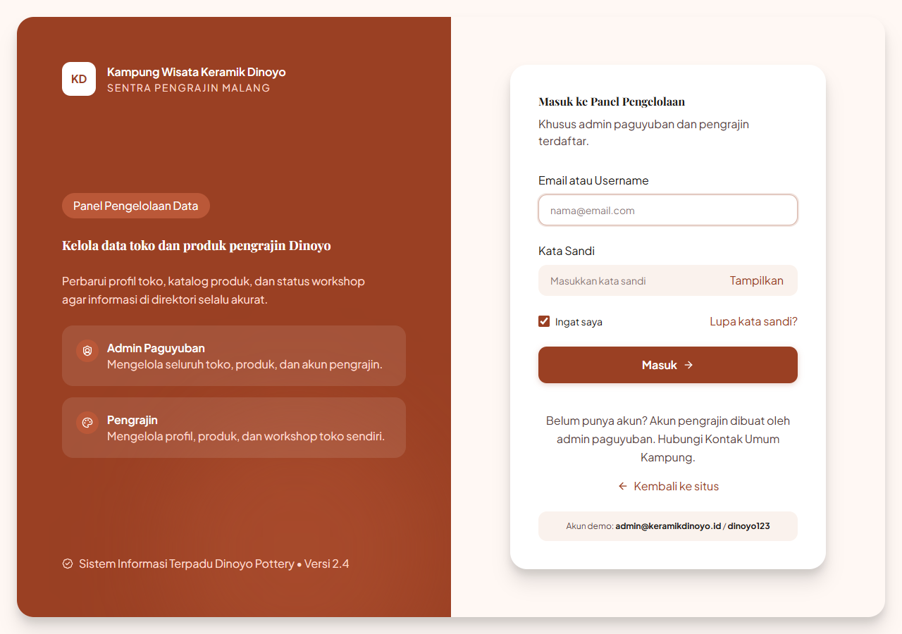 | 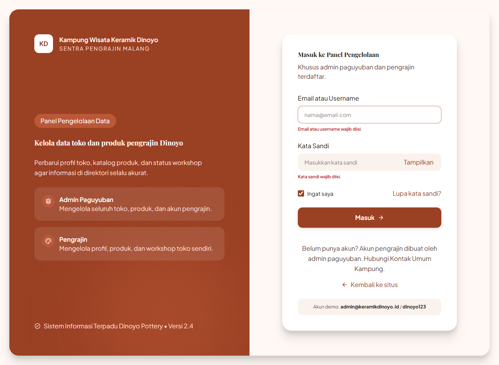 |

| Dashboard | Dashboard: mode gelap |
| --- | --- |
|  | 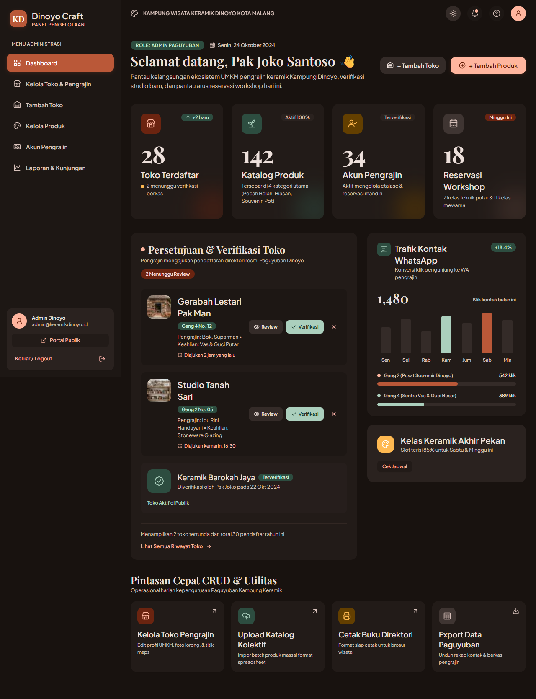 |

| Kelola Toko & Pengrajin | Tambah Toko |
| --- | --- |
| 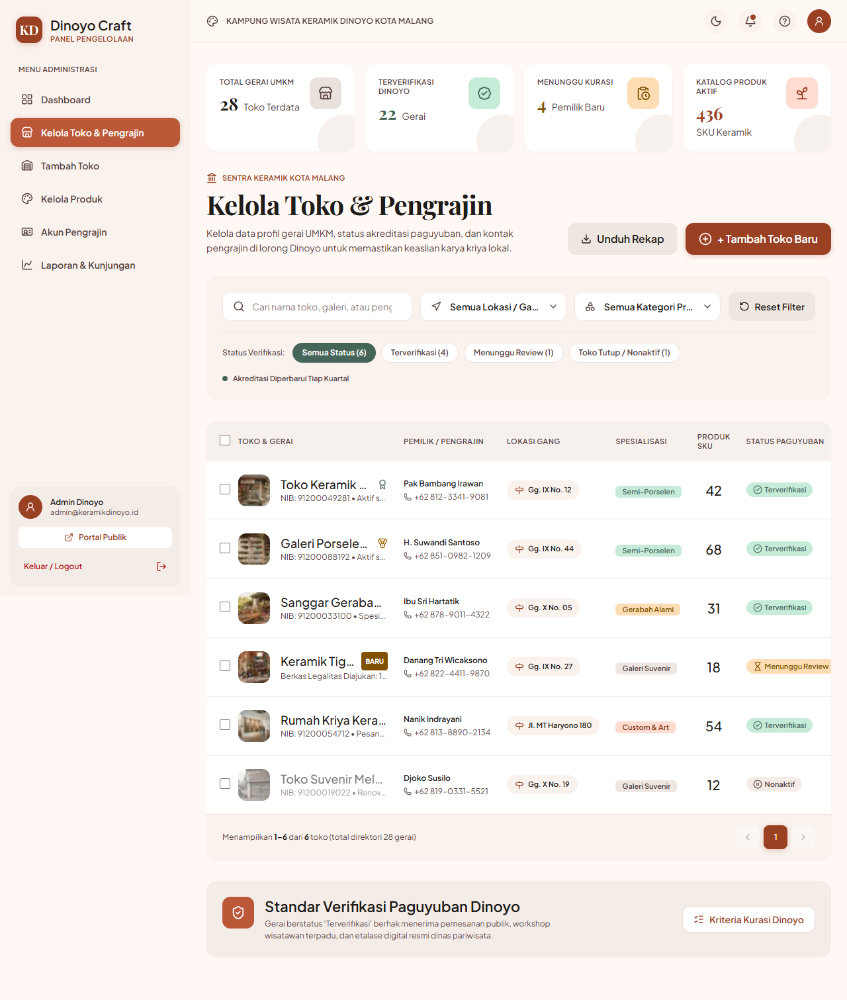 | 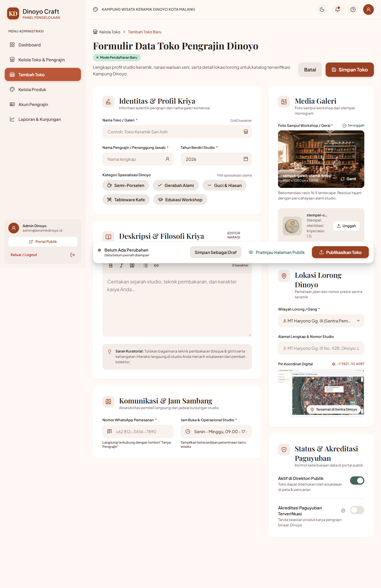 |

| Kelola Produk & Katalog | Kelola Akun Pengrajin |
| --- | --- |
| 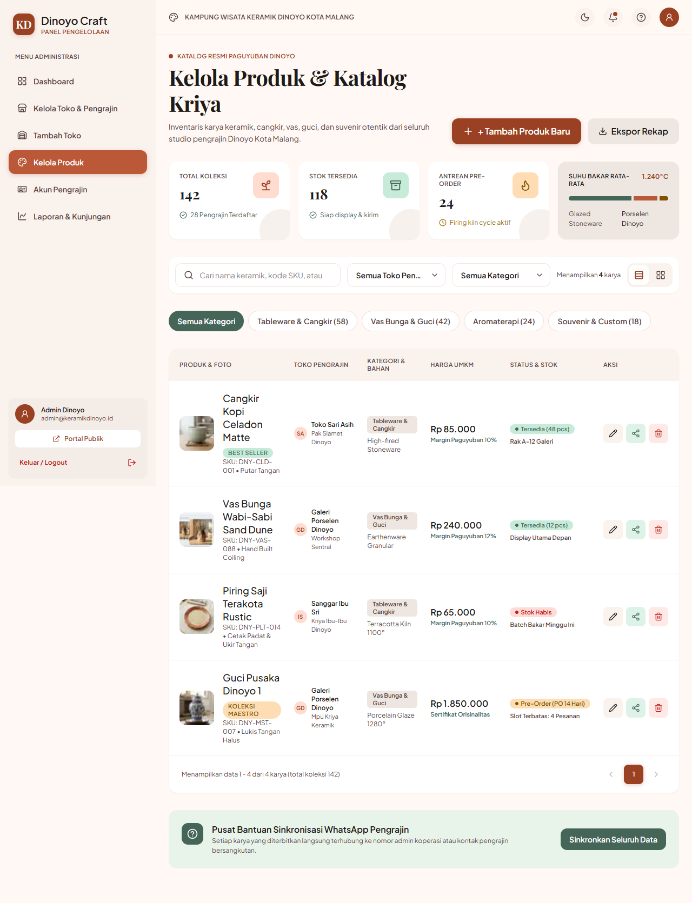 | 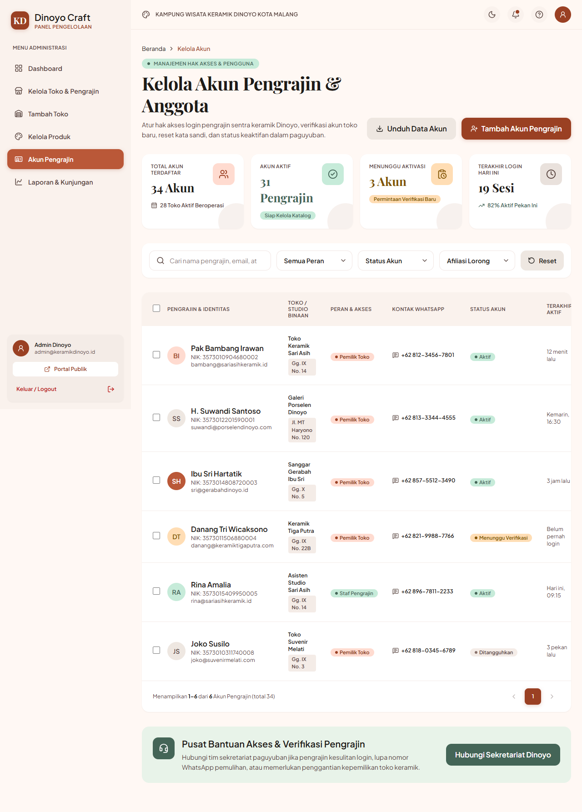 |

| Laporan Kunjungan & Reservasi | Konfirmasi Logout |
| --- | --- |
| 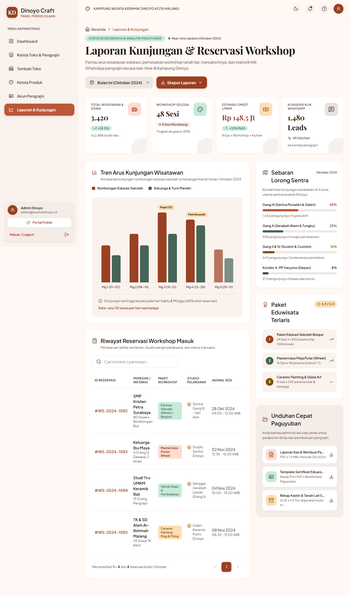 | 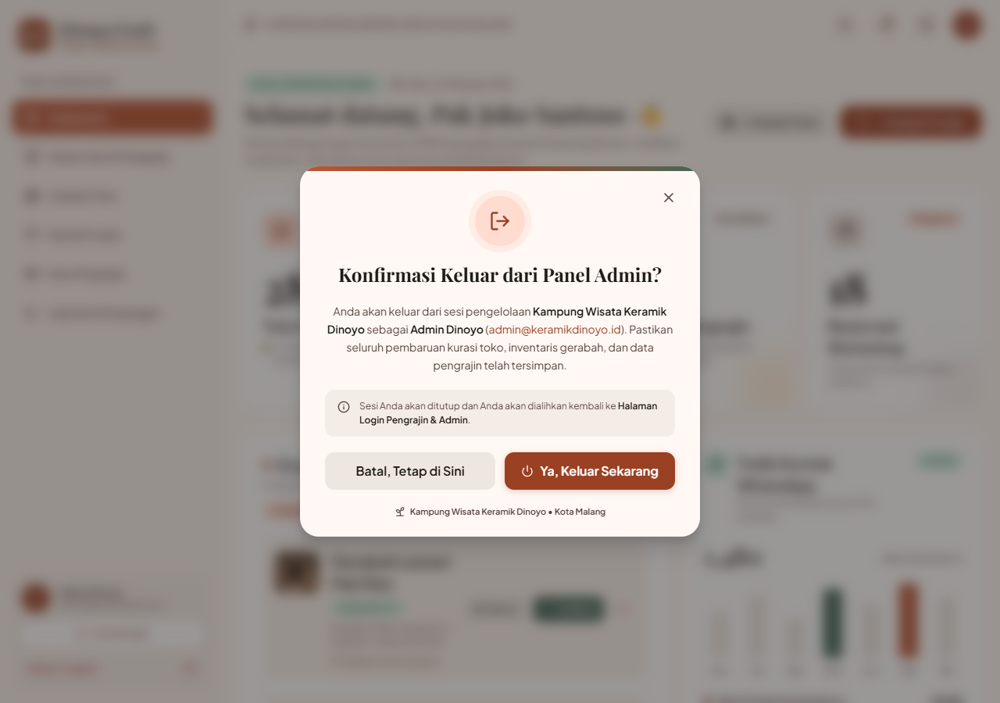 |

| Edit Toko (rute dinamis `/toko/[slug]`) | Error boundary saat API Express mati |
| --- | --- |
| 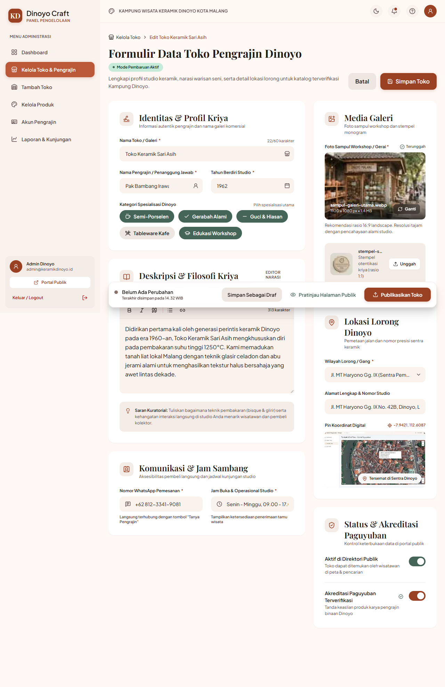 | 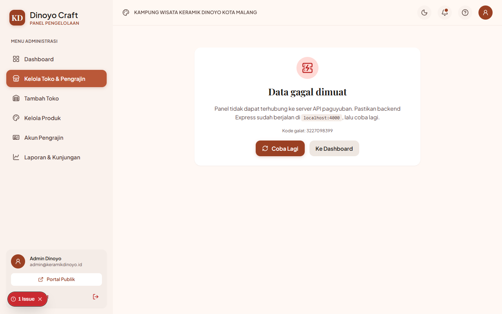 |

### Tablet (768 px) & Ponsel (375 px)

| Tablet: Dashboard | Tablet: Kelola Toko | Ponsel: Dashboard | Ponsel: Menu (drawer) | Ponsel: Kelola Toko |
| --- | --- | --- | --- | --- |
| 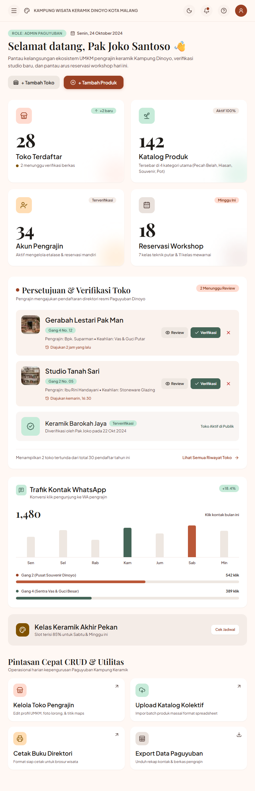 | 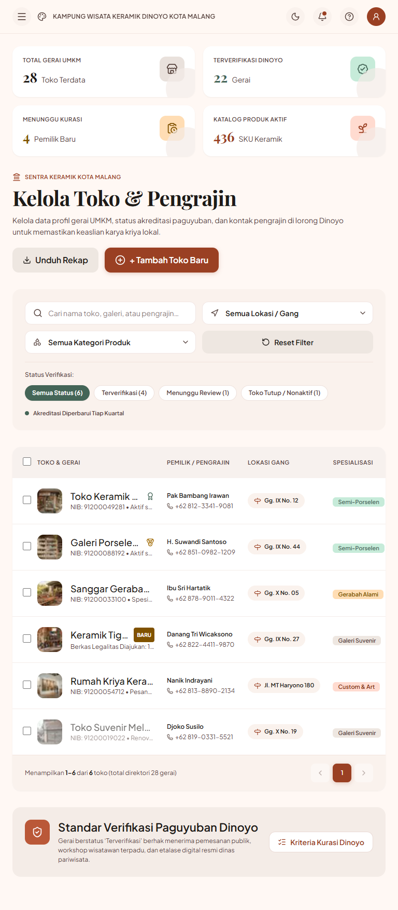 | 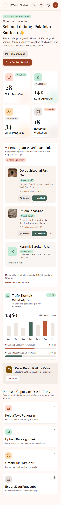 | 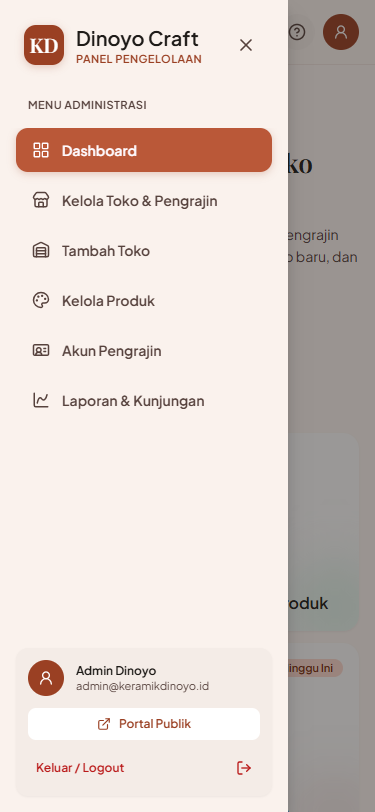 | 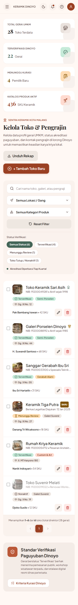 |

Seluruh screenshot (termasuk produk, akun, laporan, dan formulir di tiap ukuran) ada di [`docs/screenshots`](docs/screenshots).
